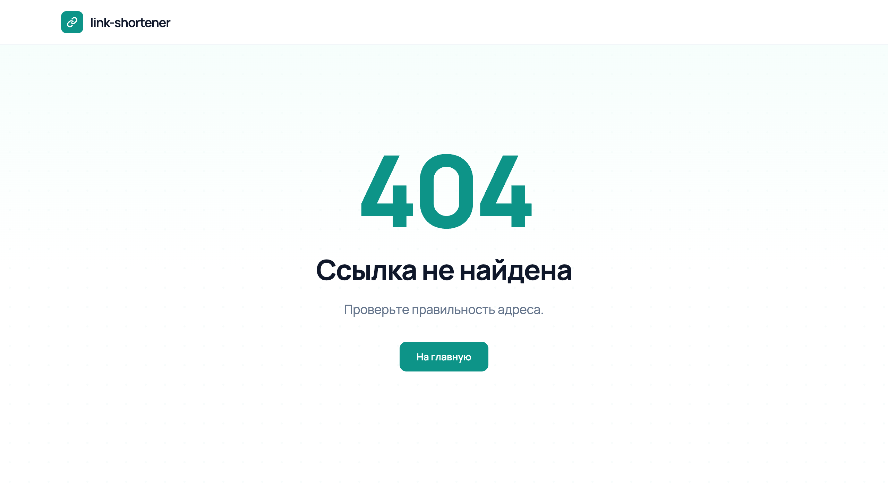
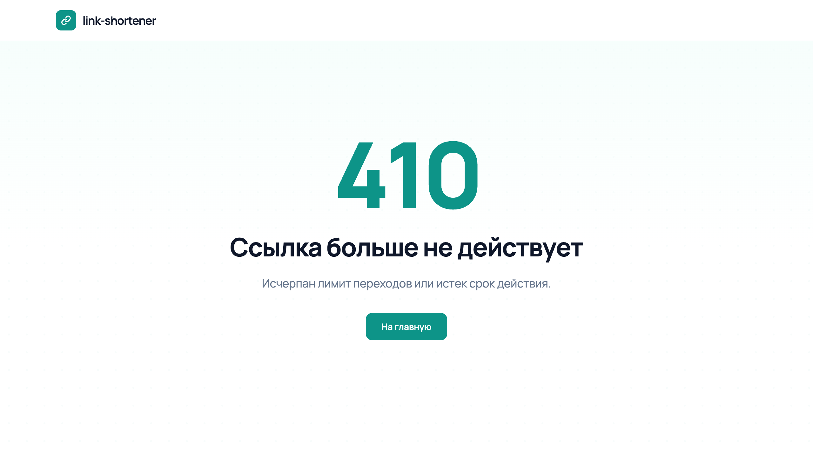
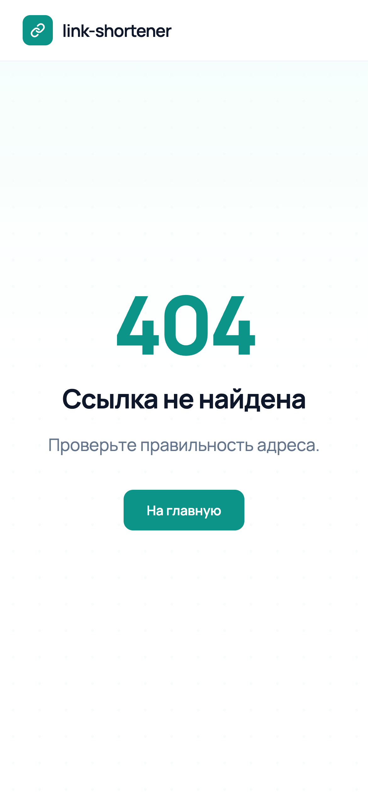
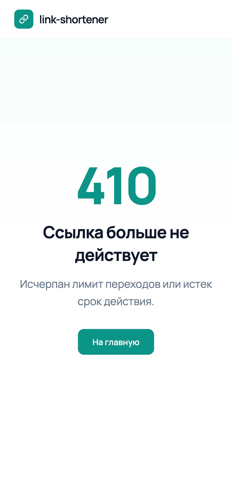

# link-shortener


Сервис коротких ссылок на Go.

Стек: Go, gin, PostgreSQL, pgx, Docker.

## Возможности

- [x] Короткая ссылка для адреса со схемой http:// или https://
- [x] Ограничение числа переходов: после лимита ссылка не открывается
- [x] Лимит соблюдается точно, даже когда по ссылке переходят одновременно
- [x] Срок жизни ссылки: после его окончания ссылка не открывается
- [x] Страница с пояснением для недоступной ссылки, в браузере она оформлена в стиле [фронтенда](https://github.com/emilburganov/link-shortener-web)

## Скриншоты

Страницы, которые видит браузер, когда ссылка недоступна.

| 404 | 410 |
|---|---|
|  |  |

На телефоне:

<p>
  
  
</p>

## Требования

- Docker 27.4

## Запуск

```bash
cp .env.example .env
```

Установите `POSTGRES_PASSWORD` в `.env`, затем:

```bash
docker compose up -d --build --wait
```

Остановка:

```bash
docker compose down
```

## API

Описание в формате OpenAPI: [api/openapi.yaml](api/openapi.yaml).

### POST /links

> Создать короткую ссылку

#### Request

```bash
curl -X POST localhost:8080/links \
  -H 'Content-Type: application/json' \
  -d '{"url": "https://example.com/page", "max_clicks": 5, "expires_at": "2030-01-02T03:04:05Z"}'
```

Поля `max_clicks` и `expires_at` необязательные. Срок жизни указывается в формате RFC 3339 и должен быть в будущем.

#### Response 201

```json
{"code": "5aVcEpZ", "short_url": "http://localhost:8080/5aVcEpZ"}
```

#### Response 400

```json
{"error": "url must be a valid http or https address"}
```

### GET /{code}

> Перейти по короткой ссылке

#### Request

```bash
curl -i localhost:8080/5aVcEpZ
```

#### Response 302

```
HTTP/1.1 302 Found
Location: https://example.com/page
```

#### Response 404

Ссылки нет. Браузер получает страницу с пояснением, остальные клиенты получают JSON.

```json
{"error": "link not found"}
```

#### Response 410

Лимит переходов исчерпан или срок жизни закончился. Для браузера тоже есть страница.

```json
{"error": "link is no longer available"}
```

## Конфигурация

| Переменная | Назначение | По умолчанию |
|---|---|---|
| `APP_PORT` | Порт сервиса | Обязательная |
| `BASE_URL` | Публичный адрес сервиса для `short_url` | `http://localhost:` и порт сервиса |
| `FRONTEND_URL` | Адрес фронтенда для кнопки На главную на странице недоступной ссылки | Без кнопки |
| `POSTGRES_USER` | Пользователь БД | Обязательная |
| `POSTGRES_PASSWORD` | Пароль БД | Обязательная |
| `POSTGRES_DB` | Имя БД | Обязательная |
| `POSTGRES_SSLMODE` | Режим SSL | В Docker Compose `disable` |
| `POSTGRES_HOST` | Хост БД | `postgres` |
| `POSTGRES_PORT` | Порт БД | `5432` |
| `GIN_MODE` | Режим gin | В Docker Compose `release` |

## Структура

```
api/openapi.yaml             Описание API
cmd/app                      Точка входа
internal/config              Настройки из окружения
internal/handler             HTTP-обработчики
internal/link                Логика ссылок
internal/repository/postgres Работа с PostgreSQL
migrations                   SQL-миграции
```

## Команды

| Команда | Действие |
|---|---|
| `make help` | Показать список команд |
| `make up` | Собрать и запустить сервис в Docker |
| `make down` | Остановить сервис |
| `make logs` | Смотреть логи приложения |
| `make build` | Собрать бинарник в `bin/app` |
| `make run` | Запустить приложение локально, база в Docker |
| `make fmt` | Отформатировать код |
| `make lint` | Запустить линтеры |
| `make test` | Юнит-тесты |
| `make test-integration` | Тесты с настоящим Postgres в Docker |

## Лицензия

MIT
